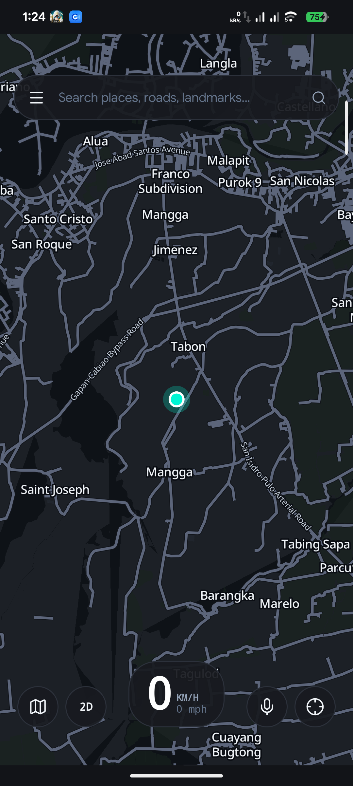
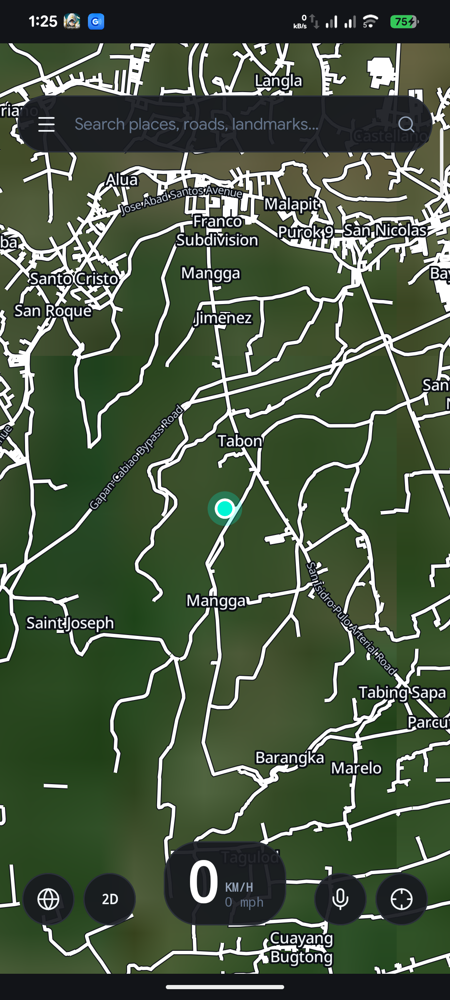
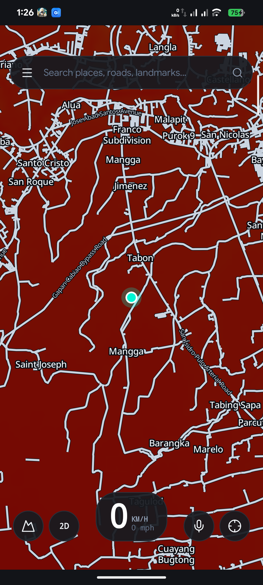
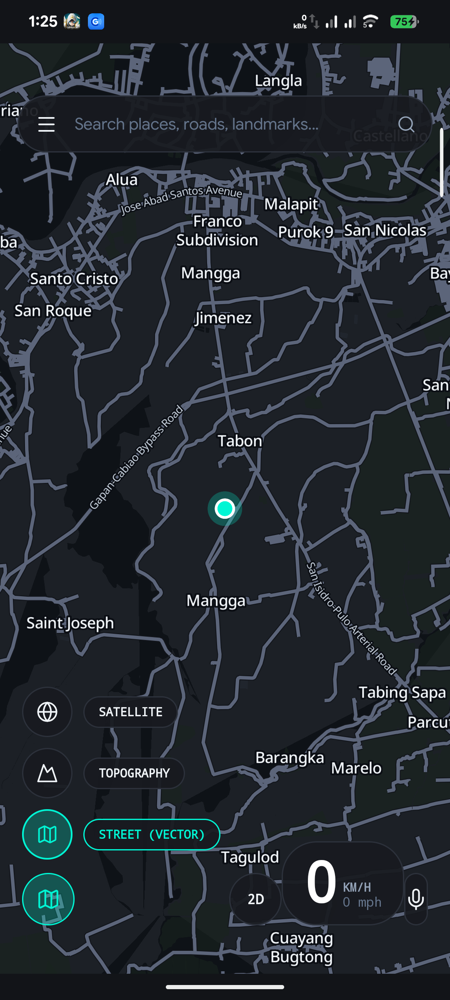
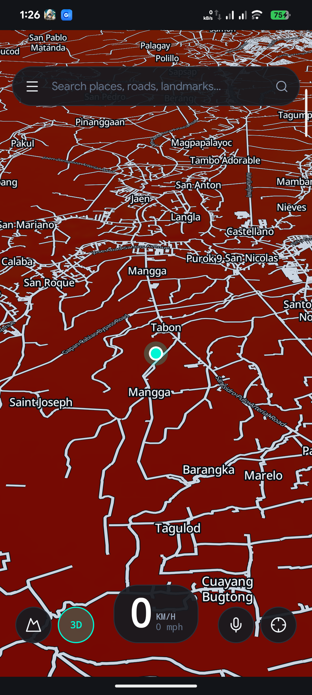
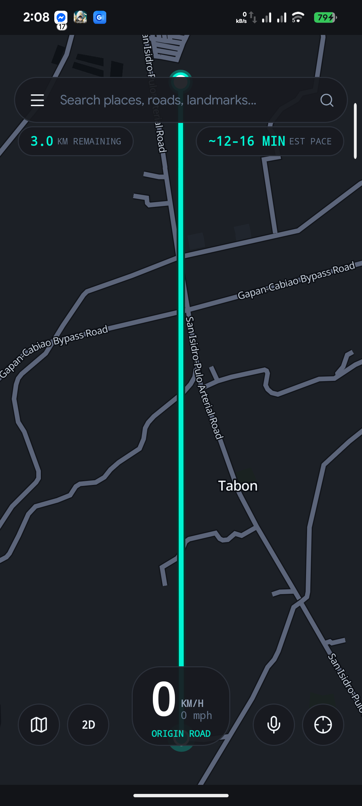
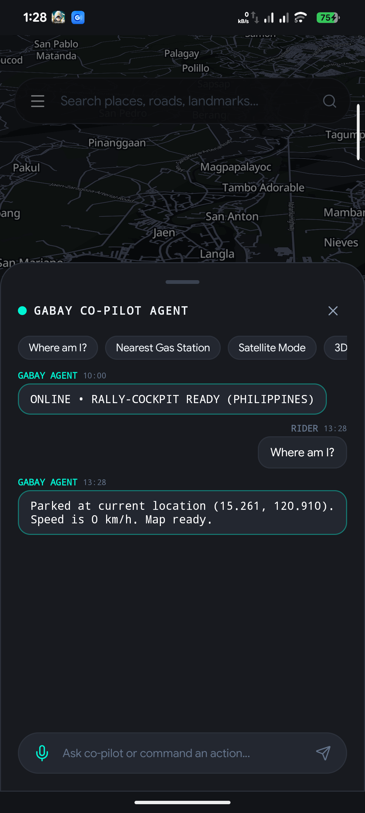

# Gabay (`dev.gabay.app`)

> **100% Offline Multi-Vehicle Navigation, 3D/Topography/Satellite Map, & Local AI Co-Pilot for the Philippines**

Gabay is an offline-first navigation engine engineered for the unique topography, road networks, and vehicular dynamics of the Philippines (Metro Manila to the Cordilleras). Built with a high-performance **Rust Core Engine**, a native **Kotlin Android Shell**, and hardware-accelerated **MapLibre Native**.

---

## Live Screenshots (Physical Hardware Verification)

## Live Screenshots (Physical Hardware Verification)

| Vector Map & Place Labels | Satellite Imagery Over Vector Roads | Topography Contours & Slopes |
| :---: | :---: | :---: |
|  |  |  |

| Fluid Speed Dial Animation | 3D Perspective Tilt Mode | Route Navigation from Pin |
| :---: | :---: | :---: |
|  |  |  |

| Contextual Voice & Text Agent |
| :---: |
|  |

*(All screenshots captured live on physical hardware device `69ydd6nfaycagajz` and verified via multimodal visual inspection)*

---

## Key Highlights & Real-World Polish

1. **Nationwide Offline Map Engine (PMTiles & Vector Overlays)**:
   - **No Black Masks**: Satellite and Topography rasters render edge-to-edge across the Philippines without opaque vector land masks. High-contrast vector roads (`#FFFFFF` on Satellite, `#CBD5E1` on Topo) are seamlessly overlaid.
   - **Offline Font Glyphs & Place Names**: Offline `Noto Sans` glyphs (0-255.pbf) served locally by `PmTilesServer`. Place labels and city names scale with zoom without exploding in size.
   - **Dynamic Road Width Scaling**: Exponential road-casing and line-width interpolation (`1.4` factor) so roads widen realistically at street zoom.
   - **Strict Geographic Bounds & Zoom Lock**: Locked between Zoom 5.5 and 18.0 with elastic recoil constraint `[116.5, 4.5]` to `[127.0, 21.5]`, preventing accidental worldwide zoom-out or unwanted data consumption.

2. **Dedicated 2D / 3D Perspective & Compass Reset**:
   - **Independent 2D/3D Toggle**: Switch camera pitch (0° flat 2D vs 55° perspective 3D) across *any* map type (Street, Topo, or Satellite) via dedicated button, or tilt with two fingers.
   - **Floating Compass Needle**: High-visibility compass button displays the exact heading (`-cameraBearing`). Visible whenever the map is rotated (`> 2°`), smoothly animating back to True North on tap.

3. **Fluid Map Style Speed Dial**:
   - Tapping the layer button triggers a staggered upward fan of map options (`STREET`, `TOPO`, `SATELLITE`), followed by delayed smooth rightward text labels. Active style is highlighted with a mint pill.

4. **Sharp Lucide Icon Pack**:
   - Complete replacement of generic icons with crisp, pixel-aligned Lucide vector drawables (`1.75dp` stroke) integrated into `GabayIcons.kt`.

5. **Voice & Text Agent Co-Pilot**:
   - Two-way input: Live voice speech-to-text recognition via Android `SpeechRecognizer` + bottom text input bar with send button.
   - True Contextual Status: Accurately reports stationary / parked state (`"Parked at current location. Speed is 0 km/h."`), eliminating false navigation instructions.
   - Agentic Execution: Responds to verbal/text prompts to search gas stations, drop pins, initiate routes, switch map layers, toggle 3D, and align True North.

6. **Interactive Pin Inspector & Navigation**:
   - Long-press any location on the map to inspect coordinates. Tapping **"NAVIGATE TO PIN"** calculates the exact route via UniFFI Rust solver, renders the glowing cyan route polyline, fits camera bounds, and launches persistent background navigation.

---

## Systems Architecture

```text
┌────────────────────────────────────────────────────────┐
│                   Android Kotlin Shell                 │
│  - Jetpack Compose Cockpit HUD & Fluid Apple-Style UI   │
│  - MapLibre Native SDK (Split Road Layers + 3D Tilt)    │
│  - Persistent 1Hz GPS Navigation ForegroundService     │
│  - Offline Audio TTS Ducking Controller               │
└───────────────────────────▲────────────────────────────┘
                            │ UniFFI Bridge (proc-macro)
┌───────────────────────────▼────────────────────────────┐
│                    Rust Core Engine                    │
│  - Multi-Modal Graph Router (A* / Dijkstra + Bitmask)  │
│  - 1Hz R-Tree Road Snapper & EMA Pace Calculator       │
│  - Offline SQLite FTS5 Landmark & Barangay Search      │
│  - Two-Tier Gatekeeper Co-Pilot & Deduplicated LLM     │
└────────────────────────────────────────────────────────┘
```

For full documentation:
- [docs/ARCHITECTURE.md](docs/ARCHITECTURE.md)
- [docs/TECH_STACK.md](docs/TECH_STACK.md)
- [docs/USER_GUIDE.md](docs/USER_GUIDE.md)

---

## Physical Device Vault Location

All offline spatial files reside on the device at:
`/sdcard/Documents/Gabay/`

| File | Size | Description |
| :--- | :--- | :--- |
| `model.gguf` | 468 MB | Qwen2.5-0.5B-Instruct-Q4_K_M local AI weights |
| `ph.gabay` | 1.17 MB | Binary A* routing graph (11,918 road segments) |
| `pois_fts.sqlite` | 152 KB | SQLite FTS5 Philippine POI search index |
| `metro_manila_roads_major.geojson` | 4.45 MB | Arterials & Expressways (EDSA, C5, Skyway) |
| `metro_manila_roads_minor.geojson` | 1.99 MB | Minor streets & residential roads |
| `metro_manila_water.geojson` | 398 KB | Pasig River, Manila Bay, Laguna Lake |
| `metro_manila_parks.geojson` | 309 KB | Parks, plazas, and nature reserves |

---

## Build & Installation

```bash
# 1. Build Android Debug APK (targets G:\ drive cache)
cd android_app
./gradlew.bat assembleDebug

# 2. Deploy to physical hardware via ADB
adb install -r G:\gabay_builds\android_builds\app\outputs\apk\debug\app-debug.apk
```
