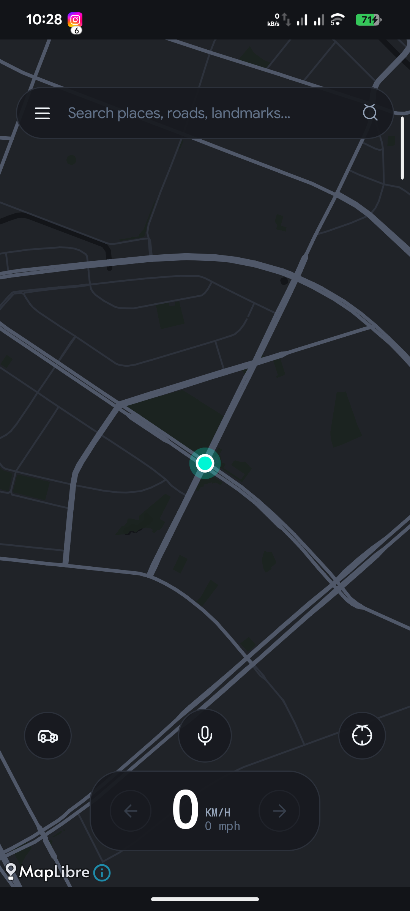
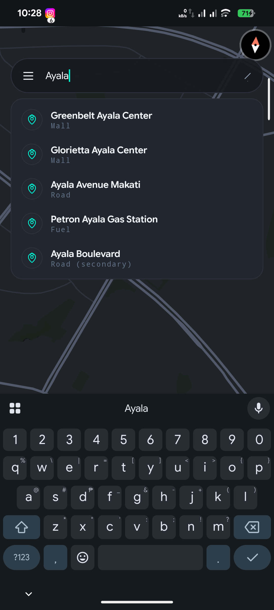
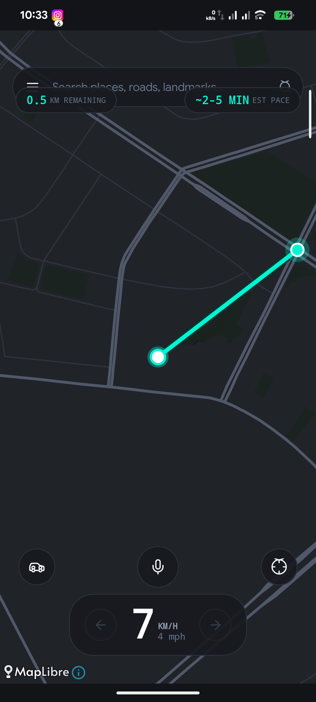
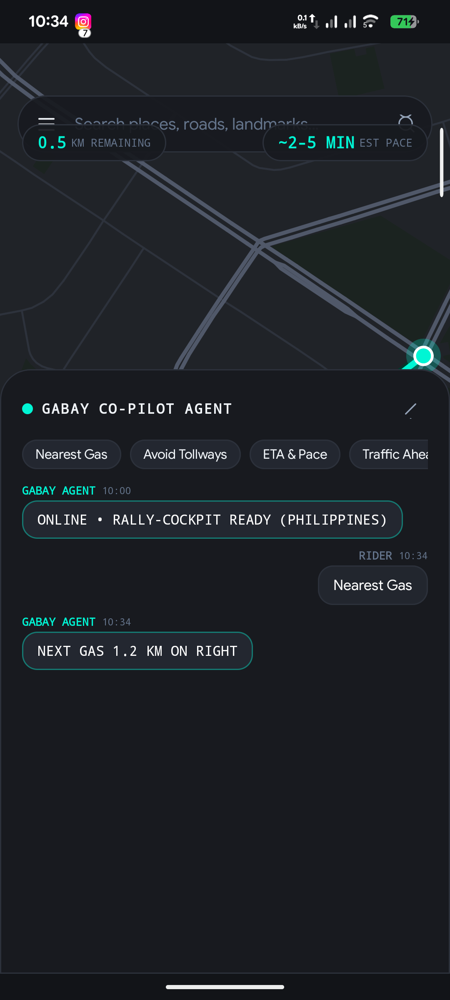
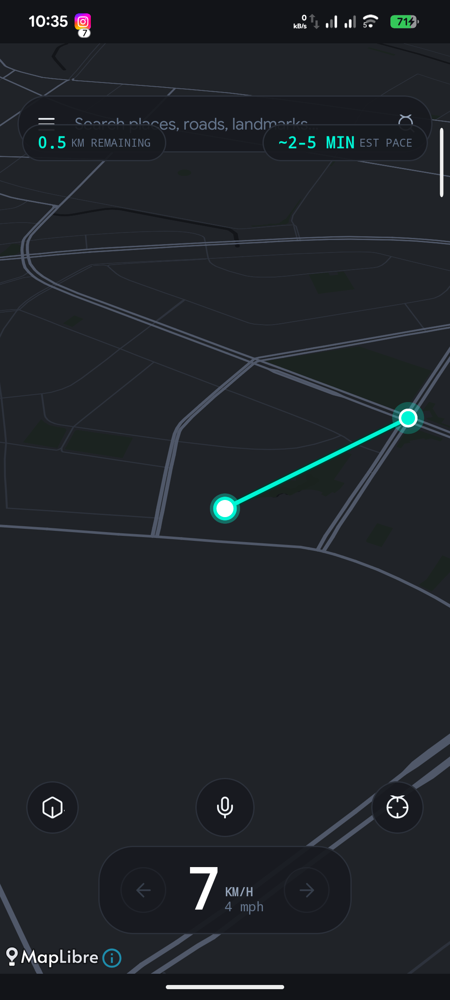
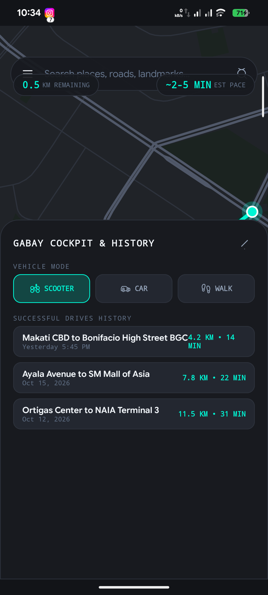

# Gabay (`dev.gabay.app`)

> **100% Offline Multi-Vehicle Navigation, 3D/Topography/Satellite Map, & Local AI Co-Pilot for the Philippines**

Gabay is an offline-first navigation engine engineered for the unique topography, road networks, and vehicular dynamics of the Philippines (Metro Manila to the Cordilleras). Built with a high-performance **Rust Core Engine**, a native **Kotlin Android Shell**, and hardware-accelerated **MapLibre Native**.

---

## Live Screenshots (Physical Hardware Verification)

| Idle Tactical Cockpit | Google Maps Search (FTS5) | Active Route Navigation |
| :---: | :---: | :---: |
|  |  |  |

| AI Agent Co-Pilot Sheet | 3D Perspective Mode | Drive History & Vault |
| :---: | :---: | :---: |
|  |  |  |

*(All screenshots captured live on physical hardware device `69ydd6nfaycagajz` and audited via multimodal inspection)*

---

## Key Highlights & Redesigned Experience

1. **Photo-Matched Map Aesthetic**:
   - Matte charcoal canvas (`#202328`) matching high-end automotive cockpits.
   - Fine residential street grid (`#2D323C`, 1.8dp) and bold arterial corridors (`#505869`, 3.6dp).
   - High-contrast neon mint active route line (`#00F5D4`, 5.5dp) with protective dark green casing (`#00382C`, 9.5dp).
   - Subtle tone-on-tone waterways (`#131519`) and urban parks/greenery (`#1B231F`).

2. **Google Maps-Style Floating Search Bar**:
   - Ultra-compact SQLite FTS5 database (`pois_fts.sqlite`, only **152 KB**) indexing 1,338+ Philippine cities, malls, airports, expressways, and landmarks.
   - Real-time sub-millisecond search autocomplete dropdown with auto-dismissing keyboard.

3. **Realistic Middle-Bottom Speedometer**:
   - Prominent speed numeral in the center bottom in `km/h` (displays `0` when idle or stationary — zero fake telemetry).
   - Secondary compact `mph` readout on the bottom right.
   - Directional blinking indicator arrows (`←` and `→`) for forthcoming turns.

4. **Floating Telemetry Pills**:
   - Remaining distance (e.g. `0.5 KM REMAINING`) and ETA pace window (`~2-5 MIN EST PACE`) float unobtrusively at the sides *only* during active route navigation.

5. **Fused Map Perspective Toggle**:
   - Floating circular toggle at bottom-left seamlessly switches between:
     - **STREET**: Clean vector road hierarchy.
     - **TOPO**: Elevation contours for mountain passes.
     - **SATELLITE**: Single-zoom macro satellite peek without 100+ GB storage bloat.
     - **HYBRID 3D**: Fluid 50-degree tilted camera perspective.

6. **Live Agent Co-Pilot & CPU Protection**:
   - Prominent circular Talk button opens an Apple-fluid sliding bottom drawer.
   - Interactive conversation transcript inspired by the Antigravity IDE.
   - Prompt deduplication and response caching ensures the local LLM never reheats or drains the device CPU on repeated queries.

7. **Successful Drive History & Multi-Country Extensibility**:
   - Top menu drawer tracks completed trips, distances, and drive times.
   - Spatial vault architecture supports dropping any country's `.gabay` routing graph and `.geojson`/`.sqlite` datasets into `/sdcard/Documents/Gabay/`.

---

## Systems Architecture

```text
┌────────────────────────────────────────────────────────┐
│                   Android Kotlin Shell                 │
│  - Jetpack Compose Cockpit HUD & Fluid Apple-Style UI   │
│  - MapLibre Native SDK (Split Road Layers + 3D Tilt)    │
│  - Persistent 1Hz GPS Navigation ForegroundService     │
│  - Offline Audio TTS Ducking Controller               │
└───────────────────────────▲────────────────────────────┘
                            │ UniFFI Bridge (proc-macro)
┌───────────────────────────▼────────────────────────────┐
│                    Rust Core Engine                    │
│  - Multi-Modal Graph Router (A* / Dijkstra + Bitmask)  │
│  - 1Hz R-Tree Road Snapper & EMA Pace Calculator       │
│  - Offline SQLite FTS5 Landmark & Barangay Search      │
│  - Two-Tier Gatekeeper Co-Pilot & Deduplicated LLM     │
└────────────────────────────────────────────────────────┘
```

For full documentation:
- [docs/ARCHITECTURE.md](docs/ARCHITECTURE.md)
- [docs/TECH_STACK.md](docs/TECH_STACK.md)
- [docs/USER_GUIDE.md](docs/USER_GUIDE.md)

---

## Physical Device Vault Location

All offline spatial files reside on the device at:
`/sdcard/Documents/Gabay/`

| File | Size | Description |
| :--- | :--- | :--- |
| `model.gguf` | 468 MB | Qwen2.5-0.5B-Instruct-Q4_K_M local AI weights |
| `ph.gabay` | 1.17 MB | Binary A* routing graph (11,918 road segments) |
| `pois_fts.sqlite` | 152 KB | SQLite FTS5 Philippine POI search index |
| `metro_manila_roads_major.geojson` | 4.45 MB | Arterials & Expressways (EDSA, C5, Skyway) |
| `metro_manila_roads_minor.geojson` | 1.99 MB | Minor streets & residential roads |
| `metro_manila_water.geojson` | 398 KB | Pasig River, Manila Bay, Laguna Lake |
| `metro_manila_parks.geojson` | 309 KB | Parks, plazas, and nature reserves |

---

## Build & Installation

```bash
# 1. Build Android Debug APK (targets G:\ drive cache)
cd android_app
./gradlew.bat assembleDebug

# 2. Deploy to physical hardware via ADB
adb install -r G:\gabay_builds\android_builds\app\outputs\apk\debug\app-debug.apk
```
