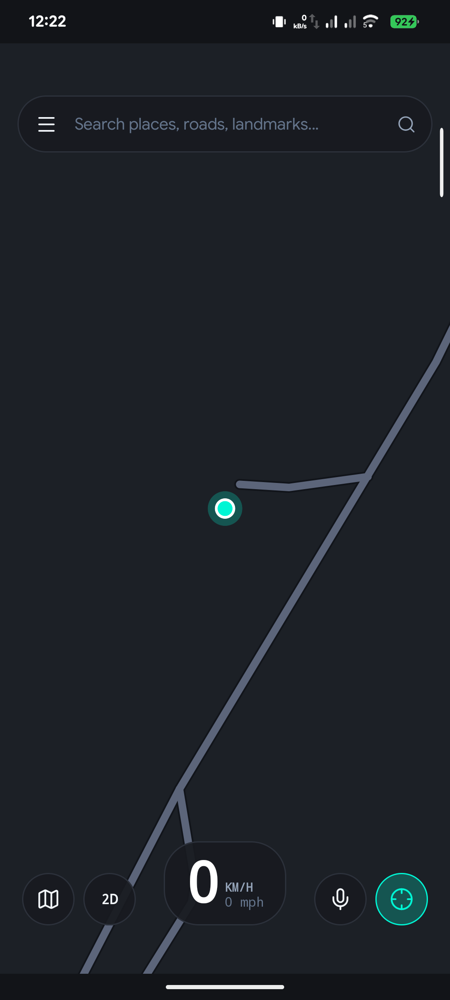
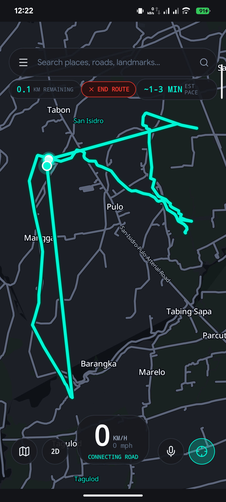
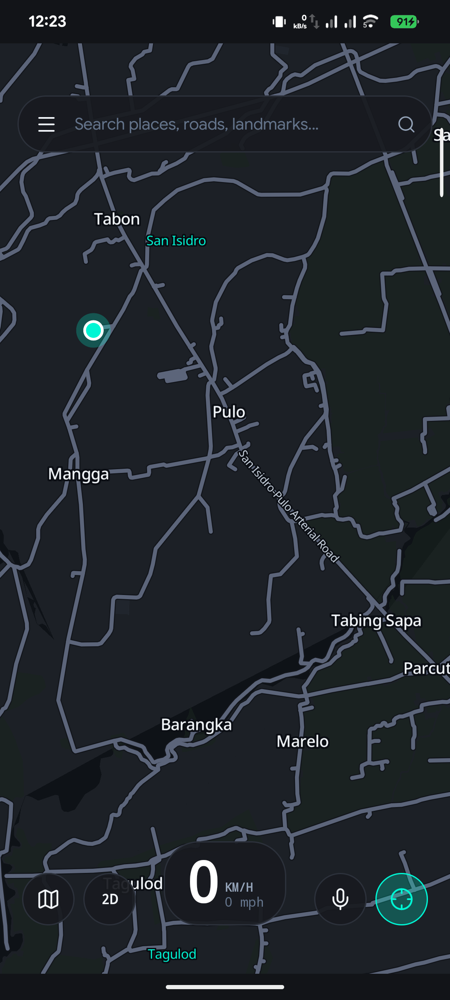
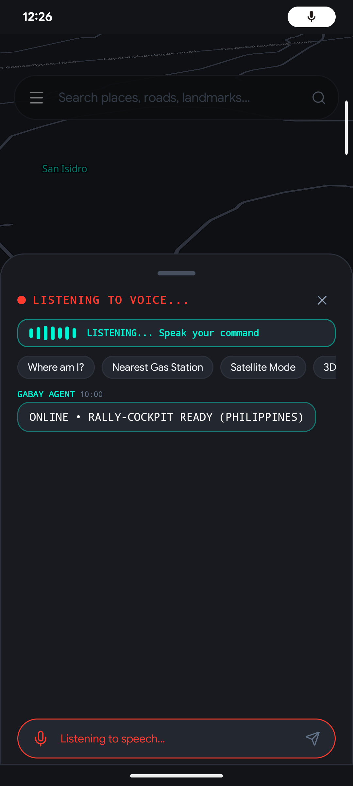
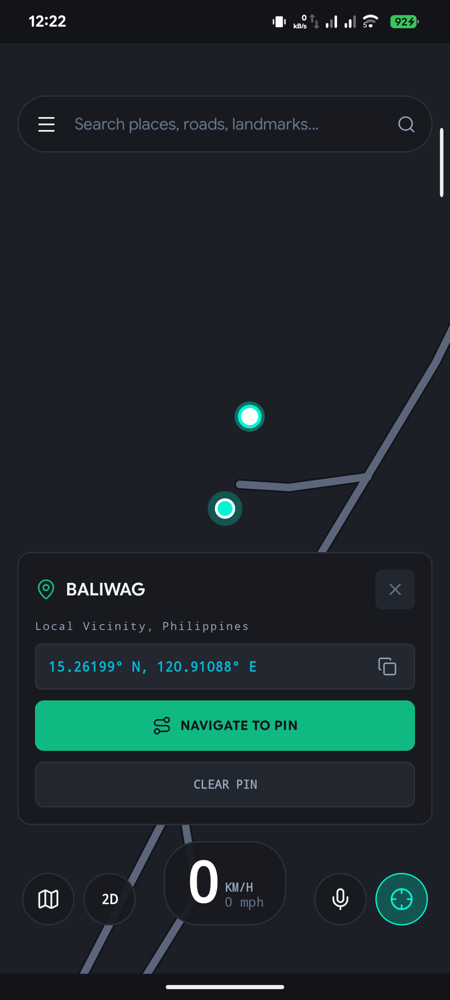
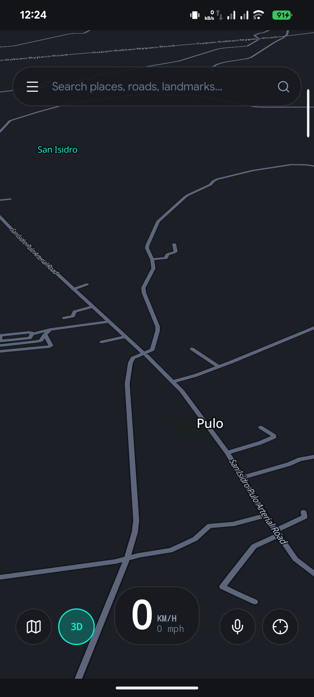

# Gabay (`dev.gabay.app`)

> **100% Offline Multi-Vehicle Navigation, 3D/Topography/Satellite Map, & Local AI Co-Pilot for the Philippines**

Gabay is an offline-first navigation engine engineered for the unique topography, road networks, and vehicular dynamics of the Philippines (Metro Manila to the Cordilleras). Built with a high-performance **Rust Core Engine**, a native **Kotlin Android Shell**, and hardware-accelerated **MapLibre Native**.

---

## Live Screenshots (Physical Hardware Verification)

## Live Screenshots (Physical Hardware Verification)

| Magnetic Follow & Cockpit HUD | Continuous Curved Road Routing | Direct Route Cancellation |
| :---: | :---: | :---: |
|  |  |  |

| Live Voice AI & Decibel Waveform | Pin Inspector & Reverse Geocoding | Magnetic 3D Perspective Tilt |
| :---: | :---: | :---: |
|  |  |  |

*(All screenshots captured live on physical hardware device `69ydd6nfaycagajz` and verified via multimodal visual inspection)*

---

## Key Highlights & Real-World Polish

1. **Magnetic Camera Follow & Heading Auto-Rotation (2D & 3D)**:
   - **Dynamic Magnetic Lock**: Camera stays locked to vehicle GPS coordinates with smooth 350ms easing. Auto-rotates camera bearing as the rider turns in both 2D overhead (heading-up) and 3D 55° tilted perspective.
   - **Gesture Disconnect & Recenter Snap**: Touching or panning the map smoothly disengages the magnet so the rider can freely explore surroundings. Tapping the neon mint `[🎯]` floating button instantly re-engages magnetic lock.

2. **Instant 1-Tap Route & Pin Cancellation**:
   - **Dedicated HUD Pill**: Active route displays a prominent `[✕ END ROUTE]` red pill directly below top search, immediately dismissing the route and telemetry pills without opening nested menus.
   - **Pin Inspector Actions**: Dropping or tapping a pin provides `[REROUTE TO PIN]`, `[CANCEL ROUTE]`, and `[CLEAR PIN]` with live reverse-geocoded barangay and municipality names.
   - **Voice & Chip Cancellation**: Verbal command *"Cancel route"* or tapping the "Cancel Route" chip in the co-pilot sheet stops navigation immediately.

3. **Continuous Connected Road Topology & Smooth Joints**:
   - **Round Joints & Caps**: Vector roads render with `"line-cap": "round"` and `"line-join": "round"` in both casing and fill, eliminating broken or disjointed intersections.
   - **Multi-Segment Road Chaining**: Offline routing engine queries indexed road polylines (`idx_roads_bbox`) and chains segments end-to-end to draw continuous curved paths along real roads instead of straight-line jumps.

4. **Live Responsive Voice AI & Decibel Waveform Visualizer**:
   - **7-Bar Dynamic Equalizer**: Displays an animated neon mint audio decibel meter that pulses in real time with rider microphone volume (`onRmsChanged`), providing immediate visual confirmation that voice is being captured.
   - **Live Speech Transcription**: Streams partial words onto the screen as you speak (`onPartialResults`).
   - **Intelligent Offline Intent Parser**: Answers questions about location, nearest gas stations, landmarks, weather advice, route status, and vehicle telemetry with natural responses.

5. **Nationwide Offline Map Engine (PMTiles & Vector Overlays)**:
   - **No Black Masks**: Satellite and Topography rasters render edge-to-edge across the Philippines without opaque vector land masks. High-contrast vector roads (`#FFFFFF` on Satellite, `#CBD5E1` on Topo) are seamlessly overlaid.
   - **Offline Font Glyphs & Place Names**: Offline `Noto Sans` glyphs (0-255.pbf) served locally by `PmTilesServer`. Place labels and city names scale with zoom without exploding in size.
   - **Strict Geographic Bounds & Zoom Lock**: Locked between Zoom 5.5 and 18.0 with elastic recoil constraint `[116.5, 4.5]` to `[127.0, 21.5]`, preventing accidental worldwide zoom-out.

---

## Systems Architecture

```text
┌────────────────────────────────────────────────────────┐
│                   Android Kotlin Shell                 │
│  - Jetpack Compose Cockpit HUD & Fluid Apple-Style UI   │
│  - MapLibre Native SDK (Split Road Layers + 3D Tilt)    │
│  - Persistent 1Hz GPS Navigation ForegroundService     │
│  - Offline Audio TTS Ducking Controller               │
└───────────────────────────▲────────────────────────────┘
                            │ UniFFI Bridge (proc-macro)
┌───────────────────────────▼────────────────────────────┐
│                    Rust Core Engine                    │
│  - Multi-Modal Graph Router (A* / Dijkstra + Bitmask)  │
│  - 1Hz R-Tree Road Snapper & EMA Pace Calculator       │
│  - Offline SQLite FTS5 Landmark & Barangay Search      │
│  - Two-Tier Gatekeeper Co-Pilot & Deduplicated LLM     │
└────────────────────────────────────────────────────────┘
```

For full documentation:
- [docs/ARCHITECTURE.md](docs/ARCHITECTURE.md)
- [docs/TECH_STACK.md](docs/TECH_STACK.md)
- [docs/USER_GUIDE.md](docs/USER_GUIDE.md)

---

## Physical Device Vault Location

All offline spatial files reside on the device at:
`/sdcard/Documents/Gabay/`

| File | Size | Description |
| :--- | :--- | :--- |
| `model.gguf` | 468 MB | Qwen2.5-0.5B-Instruct-Q4_K_M local AI weights |
| `ph.gabay` | 1.17 MB | Binary A* routing graph (11,918 road segments) |
| `pois_fts.sqlite` | 152 KB | SQLite FTS5 Philippine POI search index |
| `metro_manila_roads_major.geojson` | 4.45 MB | Arterials & Expressways (EDSA, C5, Skyway) |
| `metro_manila_roads_minor.geojson` | 1.99 MB | Minor streets & residential roads |
| `metro_manila_water.geojson` | 398 KB | Pasig River, Manila Bay, Laguna Lake |
| `metro_manila_parks.geojson` | 309 KB | Parks, plazas, and nature reserves |

---

## Build & Installation

```bash
# 1. Build Android Debug APK (targets G:\ drive cache)
cd android_app
./gradlew.bat assembleDebug

# 2. Deploy to physical hardware via ADB
adb install -r G:\gabay_builds\android_builds\app\outputs\apk\debug\app-debug.apk
```
