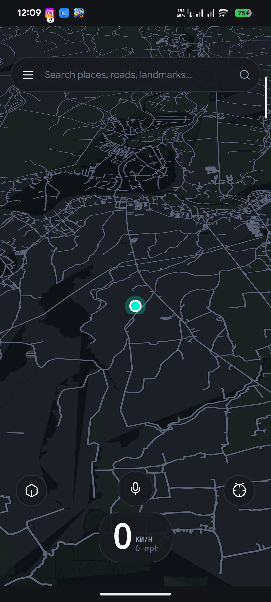

# Gabay User Guide & Field Manual

A practical operational guide for using **Gabay (`dev.gabay.app`)** on Android devices.

---

## 1. First-Time Setup & Device Vault

Gabay operates 100% offline. All map data, routing graphs, and AI models reside in your device's external storage directory:

```text
/sdcard/Documents/Gabay/
```

Before first launch, ensure your map files are placed in this directory (or pushed automatically via the provided `scripts/fetch_and_build_assets.sh` script):
- `philippines_vector.pmtiles`
- `satellite_base.pmtiles`
- `topography_contours.pmtiles`
- `ph.gabay`
- `pois_fts.sqlite`
- `model.gguf`

The app requests `MANAGE_EXTERNAL_STORAGE` and `ACCESS_FINE_LOCATION` on first launch to access this vault and read GPS data.

---

## 2. Cockpit HUD & Telemetry Interface

The Gabay interface is engineered for high visibility in bright tropical sunlight while mounted on a motorcycle or car dashboard:

```text
┌────────────────────────────────────────────────────────┐
│  [TURN_LEFT_ICON]  450 M  EDSA / GUADALUPE FLYOVER     │ Top Maneuver Banner
│  [NO TOLL] [NO EXPWY]                                  │
├────────────────────────────────────────────────────────┤
│                                                        │
│                                                        │
│                    MapLibre Canvas                     │
│                (Vector / 3D / Satellite)              │
│                                                        │
│                                                        │
├────────────────────────┬───────────────┬───────────────┤
│ 58 KM/H        HEADING │ 14.2 KM       │ [GABAY VOICE] │ Bottom Dock
│ 00:32 RUNNING      SSW │ ~24-28 MIN    │ [SAT][TOPO]   │
└────────────────────────┴───────────────┴───────────────┘
```

### Telemetry Breakdown
- **Top Maneuver Banner**: Displays upcoming turn direction vector, remaining distance to maneuver, street/flyover name, and avoidance indicators.
- **Speed & Heading**: Real-time GPS velocity rendered in tabular monospace (`tnum`) to eliminate digit jitter.
- **Distance & Dynamic Pace**: Displays remaining distance in kilometers and an adaptive rolling pace window (`~XX-YY MIN`) computed using exponential moving averages.
- **Layer Controls**:
  - `[SAT]`: Toggles the macroscopic satellite peek layer.
  - `[TOPO]`: Toggles the elevation contours layer for checking mountain slopes and elevation changes.
  - `[3D]`: Toggles 3D building polygon extrusions.

---

## 3. Vehicle Modes & Avoidances

Tap the vehicle selector to switch routing behavior:
- **`[SCOOTER]`**: Avoids expressways/tollways (NLEX, SLEX, SCTEX, Skyway) and prioritizes motorcycle-legal roads, bypasses, and secondary arterials.
- **`[CAR]`**: Standard automobile routing considering one-way streets, turn restrictions, and highways.
- **`[BIKE]` / `[WALK]`**: Prioritizes local residential roads, alleys, and paths.

---

## 4. Geographic Borders & Elastic Bounce-Back

The camera navigation area is locked strictly to the Philippines. 
- If you attempt to scroll or fling the camera into neighboring countries or open ocean past national boundaries, the camera will smoothly bounce back inside Philippine territory.
- Scrolling further out past the national overview zoom level is prohibited.

---

## 5. Local AI Co-Pilot & Voice Chat

- **Voice Query (`RECORD_AUDIO`):** Tap `[GABAY VOICE]` in the bottom dock or speak a voice trigger to ask tactical route questions (e.g. *"Nearest gas station"*, *"Reroute to avoid tollways"*).
- **Audio Intercom Ducking:** Navigation announcements automatically duck background media/intercom volume to 20%, ensuring safety prompts are never missed over engine noise.
- **Terse Rally Cockpit Output:** The co-pilot responds in concise, rally-style instructions without conversational fluff (e.g. `"IN 200M RIGHT UNGKA FLYOVER"`, `"OFF-ROUTE +40M REROUTING"`).
- **Zero CPU Throttling:** Built on an event-driven two-tier architecture that sleeps during normal travel, preventing your device from heating up or wasting battery.

---

## 6. Using Gabay in Other Countries (Multi-Country Maps)

Gabay is not locked to one geography in source code; it dynamically adapts to any region installed in your device vault:

1. Obtain a vector PMTiles map of your country or province (e.g., from Protomaps or converted via `tilemaker`).
2. Build or obtain the corresponding `.gabay` routing graph and `pois_fts.sqlite` database using `tools/map_builder`.
3. Drop the files into `/sdcard/Documents/Gabay/`:
   ```text
   /sdcard/Documents/Gabay/
   ├── <region>_vector.pmtiles
   ├── <region>.gabay
   ├── pois_fts.sqlite
   └── model.gguf
   ```
4. On launch, Gabay inspects the vector PMTiles bounding box header, automatically configures the map canvas, binds the elastic bounce-back borders to your new country's boundaries, and routes using the local graph!

---

## 7. App Screens & UI Visuals

| 3D Cockpit Navigation | Topography Elevation View | Low-Storage Satellite Peek |
| :---: | :---: | :---: |
|  |  |  |

*(Screenshots captured directly from the live device during Phase QA audits)*
